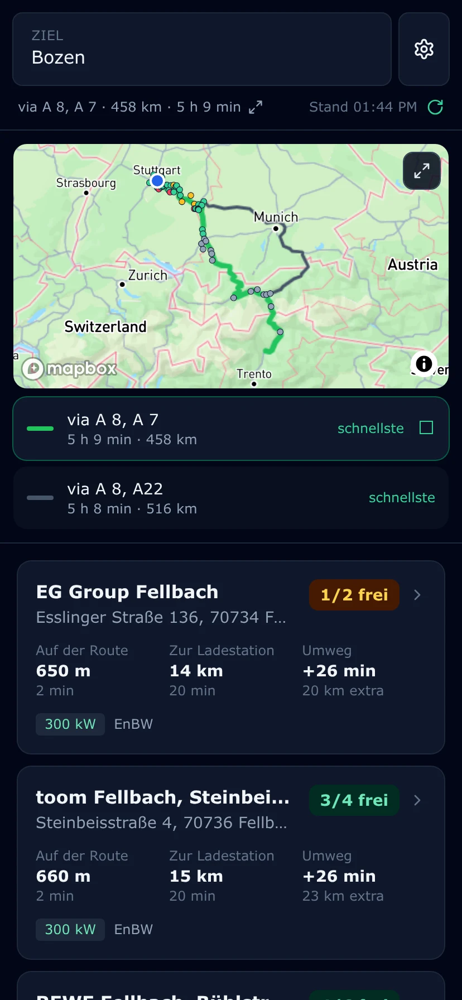
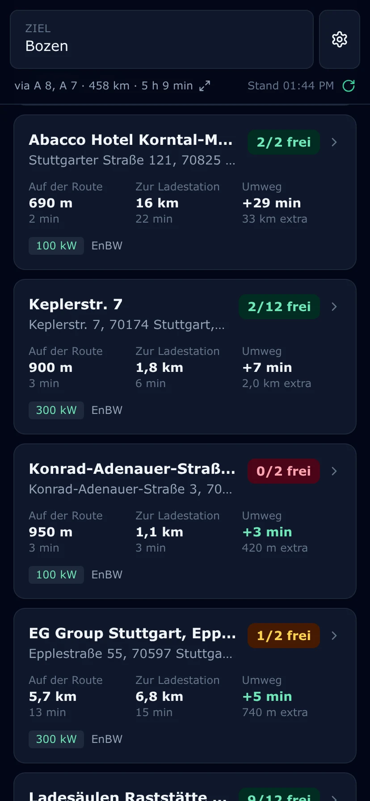
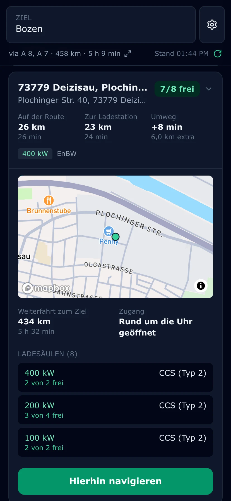
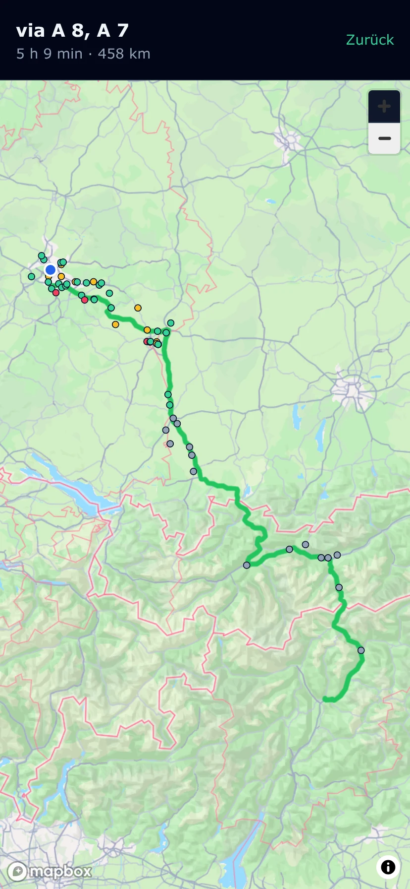
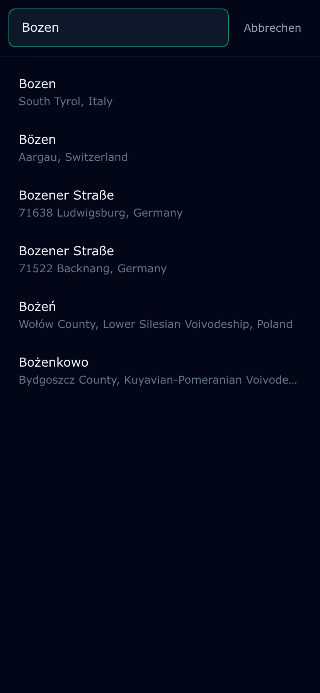
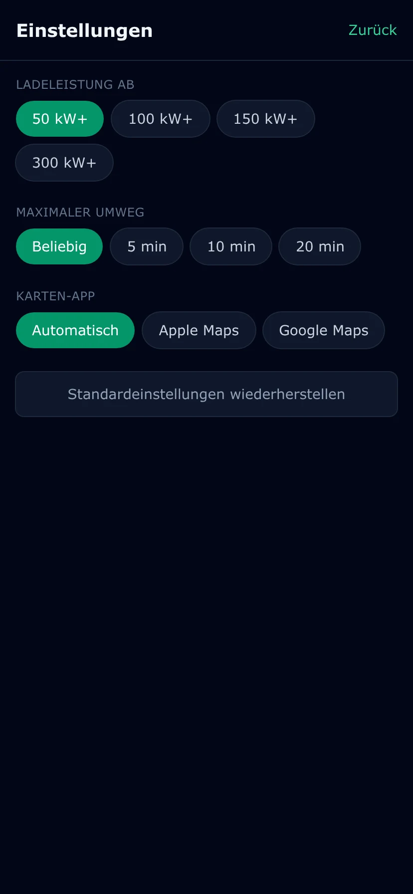

# Ladestopp — EnBW chargers along your route

A mobile-browser SPA. Enter a destination and get the chargers along the route, in
the order you drive past them, each showing how far away it is (km and minutes), how
much detour it costs (minutes), and how many charge points are free right now. Tapping
a charger opens it in place: a map of where it actually sits, the four numbers that decide
whether to stop there, its individual charge points, and a Navigate button that hands off to
Apple or Google Maps. Your last destination is remembered, so reopening the app mid-trip
picks up where you left off.

No accounts, no server-side state — destination history and settings live in
`localStorage`. The interface is in German.

## Screenshots

<table>
  <tr>
    <td width="33%"></td>
    <td width="33%"></td>
    <td width="33%"></td>
  </tr>
  <tr>
    <td><b>The route and what is on it.</b> Up to three alternatives drawn on one map, each with its road summary — tap a line or a row to switch.</td>
    <td><b>Chargers in driving order.</b> Distance along the route, distance to the station, and what the stop costs in minutes. The badge is how many points are free.</td>
    <td><b>One charger, opened in place.</b> Where it sits, how far it still is to the destination, every charge point at its own power and plug, and one deliberate Navigate tap.</td>
  </tr>
  <tr>
    <td></td>
    <td></td>
    <td></td>
  </tr>
  <tr>
    <td><b>Full screen when the question is "does this really go that way".</b> Chargers carry the same three availability colours as the list.</td>
    <td><b>Destination search.</b> Towns, addresses and POIs in one ranked list, each with its own icon; the last one is remembered.</td>
    <td><b>Settings.</b> A power floor, a detour cap, and which maps app to hand off to.</td>
  </tr>
</table>

## What it does

- **Lists chargers in route order** — the order you drive past them, never sorted by
  anything else.
- **Prices the stop, not the distance.** The detour column is what stopping adds over
  driving past the same spot, which is the number that decides whether a charger two
  kilometres off the motorway is worth it.
- **Says what is free right now**, fetched per charger when the list is drawn, with a
  Refresh in the header that re-fetches occupancy only. A charger whose live record did
  not arrive reads `?/4` rather than guessing.
- **Shows every charge point** of an opened station with its own power and plugs — a
  300 kW hub with 22 kW posts beside it is not eight fast stalls.
- **Offers the route alternatives Mapbox returns**, drawn together on one map so only
  the stretch where they part company stands out.
- **Hands off to Apple or Google Maps** with one deliberate tap, once you have decided.
- **Filters by power and detour** — the floor only ever goes up from 50 kW, because an
  11 kW post is not a stop you make mid-drive.
- **Installs to the home screen** and runs standalone, remembering your last destination.

Covered: every station on the EnBW tariff at 50 kW and above — about 2,400 of them, in
Germany, Austria, Czechia and northern Italy. See [Limitations](#limitations).

## Setup

This project uses **pnpm**, pinned via the `packageManager` field. Node ships with
Corepack, so you do not need a global install:

```bash
corepack enable pnpm   # once per machine
pnpm install
```

**1. Mapbox token** (routing, detour, destination search)

Create a free token at [account.mapbox.com](https://account.mapbox.com/access-tokens/),
then:

```bash
cp .env.example .env
# edit .env and paste your pk.* token
```

**Scopes: none required.** The three APIs this app calls — Search Box v1, Directions
v5, and Directions-Matrix v1 — are public APIs that work with any valid public token.
Use the _Default public token_, or create a new one and leave the scope checkboxes at
their defaults. The default public scopes (`styles:tiles`, `styles:read`, `fonts:read`,
`datasets:read`, `vision:read`) cover styles and tiles; none of them gate routing or
search. Mapbox lists a required scope in an endpoint's docs whenever the default token
lacks it, and these three list none.

It must be a **`pk.`** token, not `sk.` — the token ships in the JS bundle, so a secret
token would be published. `src/services/mapbox/client.ts` refuses anything that does not start
with `pk.`.

Because the token is public, **URL restrictions are the actual security control**. Add
`http://localhost:5173/*` and your deployed origin in the token settings. Note that URL
restrictions are incompatible with Mapbox's _native_ SDKs — fine for this browser SPA,
but it would break if you ever wrapped it in a native shell.

**2. EnBW subscription key** (station list and live availability)

EnBW has no official public API. The app uses the undocumented endpoint behind
EnBW's own charger map, which needs the same subscription key that map sends.
To find it: open <https://www.enbw.com/elektromobilitaet/produkte/mobilityplus-app/ladestation-finden/map>,
open DevTools → Network, and read the `Ocp-Apim-Subscription-Key` request header
on any `chargestations` call.

```bash
echo 'ENBW_SUBSCRIPTION_KEY=<the key>' > .dev.vars   # local dev
pnpm wrangler secret put ENBW_SUBSCRIPTION_KEY       # production
```

**3. Build the station list**

The app ships with a list of every EnBW-tariff station and only asks the API about
occupancy. Generate it once:

```bash
pnpm build:stations                                   # DE + AT + CZ + northern Italy
pnpm build:stations -- --bbox 48.55,48.85,9.0,9.4     # a small region, for a quick check
```

It writes `data/stations.enbw.json`, which is committed. Re-run it every month or so, and
after any run of stale rows — see [Limitations](#limitations). What the run costs and what
the file carries: [Why a static station list](docs/implementation.md#why-a-static-station-list).

## Running

The charger calls **must** go through the Worker — see
[Why a proxy](docs/implementation.md#why-a-proxy). So local dev needs both processes:

```bash
pnpm dev:worker   # terminal 1 — Worker on :8787
pnpm dev          # terminal 2 — app on :5173, proxies /api to the Worker
```

Geolocation needs a secure context. `localhost` counts, but a real phone on your LAN
does not — use a tunnel (`cloudflared tunnel --url http://localhost:5173`) or the
deployed URL when testing on a device.

The app ships a web manifest, so it installs to the home screen and runs standalone.
There is no service worker: installed is not offline, and it always loads fresh. What it
does not do is fetch itself again on every open — see
[Caching](docs/implementation.md#caching).

```bash
pnpm test        # unit tests, hermetic and offline
pnpm typecheck   # app + worker
pnpm build       # production bundle
```

## Deploying

`pnpm deploy:worker` for the API, and any static host for `dist/` — with two constraints.

**Route `/api/*` to the Worker.** The client calls `/api/chargers/{stationId}`
**same-origin** (`src/services/enbw/availability.ts` hard-codes the path; there is no
configurable API base). Cloudflare Pages with a Worker route on the same zone does this; a host that only
serves files does not.

**Serve `public/_headers`.** Without it every file is revalidated on every open — see
[Caching](docs/implementation.md#caching) for what that costs and why the rules are the way
they are. Cloudflare Workers and Pages both read the file; another static host needs the same
two rules expressed in its own configuration.

## Limitations

- **The station list goes stale.** New or decommissioned stations are invisible until
  `pnpm build:stations` is re-run. A station that has disappeared shows as `?/n` rather than
  a wrong number, but a _new_ one simply will not appear.
- **Only the EnBW network, and only its fast half** — about 2,400 stations at 50 kW or
  above. There is no widen-search escape hatch on routes where EnBW is thin.
- **Availability is a snapshot**, seconds to minutes stale, and a free point can be taken
  before you arrive. The header shows when it was fetched, next to a **Refresh** button.
  There is no pull-to-refresh and no auto-refresh.
- **Live occupancy and detour are fetched for the first 45 rows only.** Further down the
  list the badge reads `?/4` and the detour column reads `—`; opening such a row fetches its
  charge points on the spot, but never its detour. Because the list is in route order, those
  45 are exactly the next stops you will reach.
- **Finding the chargers takes a moment** on a long route — a few seconds on a phone,
  behind a progress bar, cached per route afterwards.
- **The EnBW endpoint is undocumented.** It can change, the key can rotate, and the
  `Origin` gate could tighten. A 403 from the Worker almost always means one of those.

The full list, with the measurements and the reasoning behind each:
[Known limitations](docs/implementation.md#known-limitations).

## Implementation notes

How it is built and why — the corridor geometry, the Worker proxy, the offline station
list, the caching rules and the API archaeology behind them — lives in
**[docs/implementation.md](docs/implementation.md)**.
